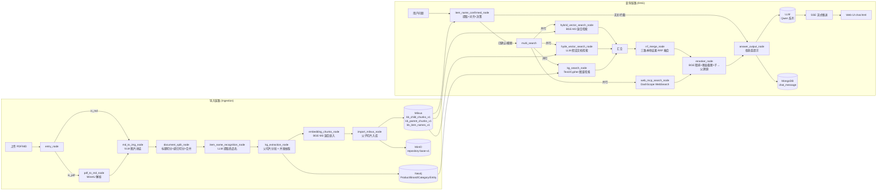

# 工业设备仪器智能运维知识库系统

> 面向工业设备技术文档的检索增强生成（RAG + GraphRAG）系统。支持 PDF/Markdown 产品资料上传、自动解析、切片、商品名识别、知识图谱抽取与向量化入库；用户提问时，通过商品名确认、向量检索 / HyDE / Neo4j 图谱检索 / 联网搜索四路召回、RRF 融合、BGE 重排序精排等 LangGraph 工作流，生成带出处、支持流式输出的专业答案。

**技术标签：** `Python 3.10` · `FastAPI` · `LangGraph` · `LangChain` · `Milvus` · `Neo4j` · `MongoDB` · `MinIO` · `BGE-M3` · `BGE-Reranker-Large` · `MinerU` · `SSE 流式输出` · `RAGAS 评测`

---

## 目录

1. [项目定位](#1-项目定位)
2. [架构设计与数据流](#2-架构设计与数据流)
3. [核心特性](#3-核心特性)
4. [快速开始](#4-快速开始)
5. [技术选型](#5-技术选型)
6. [项目结构](#6-项目结构)
7. [评估结果](#7-评估结果)
8. [已知问题与后续规划](#8-已知问题与后续规划)

---

## 1. 项目定位

本项目是一个**面向工业设备技术文档的专业 RAG 问答系统**，解决以下核心问题：

- **产品型号歧义**：用户常以口语化名称（如「万用表」「测电压的表」）提问，无法直接匹配知识库中的准确型号（如 `RS PRO RS-12 数字万用表`）。
- **结构化参数漏检**：产品手册中的额定功率、电流、尺寸、接线方式等参数分散在表格与正文中，纯向量检索容易漏掉细粒度参数。
- **检索噪声与幻觉**：单一向量检索在领域术语、跨文档场景下召回不准确，导致 LLM 幻觉。
- **数据闭环**：从文档导入、切片、嵌入、图谱抽取、入库到多路检索、重排、生成的完整链路，全部由 LangGraph 工作流编排驱动。

系统以**商品名（item_name）** 和**产品属性图**为贯穿全链路的锚点：

- 导入时用 LLM 识别每份文档的商品名，并回填到每个切片；同时抽取产品参数与关联实体，写入 Neo4j 属性图。
- 查询时先用 LLM 从用户问题与历史对话中提取商品名，再到向量库对齐出知识库内真实商品名，以此对多路检索结果做过滤；图谱链路则用 Text2Cypher 直接命中产品节点及其结构化参数。

---

## 2. 架构设计与数据流

系统由两个独立的 FastAPI 服务 + 两套 LangGraph 工作流组成：

| 服务 | 端口 | 职责 |
| --- | --- | --- |
| 导入服务 `api/import_router.py` | `8000` | 接收文件上传 → 后台运行导入图 → 提供任务状态轮询 |
| 查询服务 `api/query_router.py` | `8001` | 接收问答请求 → 后台运行查询图 → SSE 推送 → 历史管理 |

### 数据流图（Mermaid）



### 导入链路详细流程

```
entry_node (判断 PDF/MD)
  ├── is_pdf_read_enabled → pdf_to_md_node → md_to_img_node
  └── is_md_read_enabled  → md_to_img_node
                          ↓
                document_split_node (标题层级切分 + 子切片)
                          ↓
                item_name_recognition_node (LLM 提取品牌/型号/品类)
                          ↓
                kg_extraction_node (父切片分批 + 并发图谱抽取 → Neo4j)
                          ↓
                embedding_chunks_node (子切片 BGE-M3 混合向量化)
                          ↓
                import_milvus_node (父子切片入库)
```

**关键设计**：

- **父子切片架构**：父切片（默认 ≤600 字符，标题层级完整）仅存储文本，用于答案生成；子切片（200 字符，30 重叠）带向量，用于精准检索。Reranker 在子切片精排后溯源回父切片。
- **Markdown 表格线性化**：自动将 Markdown 表格转换为线性文本，提升切片语义完整性。
- **图谱旁路抽取**：商品名识别完成后，将父切片按约 8000 字符合并为批次，用 5 线程并发调用 LLM 抽取参数与关系；抽取失败只记录日志，不阻断后续向量入库。
- **小切片识别商品名**：商品名识别默认取前 3 个父切片作为上下文，兼顾准确率与 Token 成本（`item_name_chunk_size` 当前已配置但未实际参与截断）。

### 查询链路详细流程

```
item_name_confirmed_node
  ├── 无关 / 无法识别 → answer_output_node (拒绝提示) → END
  ├── 商品名已确认 (confirmed) → query_type="precise"
  └── 商品名模糊 (无 model) → query_type="fuzzy"
        ↓
   multi_search (并行分发)
  ├──→ hybrid_vector_search_node (BGE-M3 混合检索，按精准/模糊过滤)
  ├──→ hyde_vector_search_node (LLM 生成假设文档 → 混合检索)
  ├──→ kg_search_node (Text2Cypher → Neo4j → 自然语言化切片)
  └──→ web_mcp_search_node (DashScope WebSearch)
        ↓
   join (四路汇合)
        ↓
   rrf_merge_node (本地三路 RRF 融合；Web 结果直通 Reranker)
        ↓
   reranker_node (BGE 精排 + 多设备分桶 + 断崖截断 + 子→父溯源)
        ↓
   answer_output_node (组装 Prompt + LLM 生成 + SSE + 历史落库)
        ↓
   END
```

**关键设计**：

- **四路检索互补**：本地混合检索（稠密+稀疏）+ HyDE（缓解跨域不对称）+ Neo4j 图谱检索（结构化参数/多跳关系）+ 联网搜索（实时信息）。
- **精准/模糊模式**：
  - `precise` 模式：过滤 `item_name IN [...]`，Hybrid 权重 `(1.0, 0.4)`，图谱权重 `5.0`
  - `fuzzy` 模式：无过滤，Hybrid 权重 `(1.0, 1.0)`，图谱权重 `0.5`
- **RRF 融合公式**：`score = weight / (k + rank)`，`k=60`，本地三路融合后最多保留 40 条。
- **图谱直通与放行**：图谱切片以 `source=knowledge_graph`、`distance=1.0` 进入 RRF；Reranker 对 `knowledge_graph` 与 `web` 结果直接放行，不再做子→父溯源。
- **断崖截断**：自适应 Top-K（3~8），检测分数断崖 `gap ≥ 0.04`，最大断崖 `0.10`，多设备融合后硬上限 16。
- **多设备独立分桶**：对比场景下，按设备名分桶独立断崖，避免某设备被淹没。
- **Web 结果不参与 RRF**：联网结果没有 chunk_id、也不属于本地父子切片体系，设计上直接进入 Reranker 统一精排。

---

## 3. 核心特性

### 导入特性

- **多源文档导入**：支持 PDF（MinerU 解析为 Markdown）与 Markdown 直传。
- **结构化切片**：
  - 按 Markdown 标题层级（`#`~`######`）一级切分
  - 超长章节用 LangChain 递归切分器二次切分（CJK 分隔符）
  - 短章节按「同源父标题」贪心合并（>100 字）
  - 表格自动线性化
- **图片处理**：VLM（`qwen3-vl-plus`）总结图片内容（±200 字上下文），替换 Markdown 为 `[摘要](MinIO URL)`。
- **商品名识别**：LLM 提取 `{brand, model, category}`，提示词强制提取具体型号/订货号（避免把 `A9F18116` 截断成系列名 `iC65N`）；失败时降级使用文件名。商品名经 BGE-M3 向量化后写入 `kb_item_names_v1`。
- **Neo4j 图谱抽取**：
  - 动态批处理父切片（约 8000 字符/批）并并发抽取，降低 Token 消耗与 API 调用次数
  - 构建工业属性图：`Product` 节点保存 `name`、`model` 及全部动态技术参数；`Brand`、`Category` 独立建模；配件/系列/认证等写入 `Entity`
  - 固定关系：`BELONGS_TO_BRAND`、`IS_A_CATEGORY`；动态关系：`RELATED_TO`（关系描述存于 `r.type`）
- **多文件导入**：前端队列顺序处理，支持批量上传，失败后继续处理后续文件。

### 检索特性

- **混合向量检索**：BGE-M3 同时输出稠密（1024 维，COSINE）与稀疏（IP）向量，Milvus WeightedRanker 融合。
- **HyDE 检索**：LLM 生成假设性文档后检索，缓解查询-文档跨域不对称。
- **图谱检索（GraphRAG）**：
  - LLM 根据固定 Schema 动态生成只读 Cypher（Text2Cypher）
  - 单次 `MATCH` + `OR` 支持多产品对比，统一 `properties(p)` 返回全量参数，避免硬编码字段名
  - `_textualize_results` 将图数据库 JSON 转为高语义密度自然语言，适配下游 BGE Cross-Encoder 打分
  - Cypher 含写操作黑名单校验；查询末尾 `LIMIT 5`
- **联网搜索**：DashScope MCP WebSearch，补充实时信息。
- **商品名确认**：
  - 提取：LLM 从问题 + 最近 10 轮对话历史中提取多个产品特征，并重写查询
  - 对齐：Milvus 混合检索碰撞库内商品名，顺延占位避免多产品名称冲突
  - 决策：无关拒绝 → 已确认走精准 → 未确认走模糊；置信度阈值由 `ITEM_NAME_CONFIDENCE` 控制（默认 `0.6`）
- **RRF 融合**：多路结果按 `chunk_id` 去重融合，权重按 `precise` / `fuzzy` 动态路由。
- **BGE 重排序**：
  - 图片/短文本（<15 字符）过滤
  - 设备名注入提升参数表格语义匹配
  - 多设备独立分桶 + 断崖截断 + 全局硬上限
  - 子切片精排 → 父切片溯源（继承最高分）
  - Sigmoid 归一化映射到 (0,1)，低分阈值过滤（默认 `0.3`）

### 生成特性

- **Prompt 优化**：
  - 局部作答静默规则：未知参数不输出“未提及”
  - 完整主谓结构，禁止代词
  - 图片输出规范（仅视觉问题时追加）
- **流式输出**：SSE 事件（`delta`, `final`）实时推送，非流式同步调用亦支持。
- **对话历史管理**：MongoDB 持久化 `chat_message`（含重写查询、商品名、时间戳），支持查询/清空。
- **任务状态追踪**：导入/查询均以 `task_id` 追踪，前端可轮询节点执行状态与耗时。
- **Web UI**：`chat.html` 支持流式问答、历史会话、左侧问题大纲导航；`import.html` 支持批量上传与队列进度。

### 评测与调试

- **RAGAS 四维评测**：忠实度（Faithfulness）、回答相关度（Answer Relevancy）、上下文召回率（Context Recall）、上下文精确率（Context Precision）。
- **性能埋点**：上下文 Token 数（Avg / P95 / P99）与端到端响应时间（Avg / P50 / P95 / P99），用于量化断崖截断的上下文压缩率与多路召回延迟。
- **断点续评**：`evaluate_resume.py` 读取中断的 CSV，只对缺失分数的样本补评，再重算均分并输出 `*_fixed.csv` 与摘要。
- **阈值配置化**：商品名置信度、RRF 权重、Reranker Top-K/断崖阈值等集中在 `QueryConfig`，支持环境变量覆盖。

---

## 4. 快速开始

### 4.1 环境依赖

| 依赖 | 要求 |
| --- | --- |
| **Python** | **3.10**（开发环境；仓库已移除 `pyproject.toml`，无版本锁文件） |
| **显卡 / CUDA** | 建议 NVIDIA GPU（BGE-M3 / Reranker 推荐 `cuda:0`） |
| **外部服务** | Milvus（向量库）、Neo4j（图谱库）、MongoDB（对话历史）、MinIO（对象存储） |
| **LLM 服务** | 阿里云 DashScope（OpenAI 兼容模式） |
| **模型下载** | ModelScope（MinerU、BGE-M3、BGE-Reranker） |

### 4.2 安装步骤

```bash
# 1. 克隆项目
git clone <your-repo-url> && cd RAG_repository

# 2. 创建虚拟环境（Python 3.10）
python -m venv .venv
.venv\Scripts\Activate  # Windows PowerShell
# source .venv/bin/activate  # Linux/macOS

# 3. 安装依赖
cd repository
pip install -r requirements.txt

# 4. 补充图谱与评测依赖
# requirements.txt 目前未显式列出以下包，运行图谱链路 / RAGAS 前需安装
pip install neo4j ragas datasets tiktoken

# 5. 配置环境变量
# 在 repository/.env 中填写配置（.env 已被 .gitignore 忽略，请勿提交真实密钥）
```

### 4.3 环境变量配置（`repository/.env`）

```bash
# ==================== LLM / DashScope ====================
OPENAI_API_KEY=<your-dashscope-api-key>    # DashScope API 密钥
OPENAI_API_BASE=https://dashscope.aliyuncs.com/compatible-mode/v1
LLM_DEFAULT_MODEL=qwen-plus                # 生成 / 抽取主模型
VL_MODEL=qwen3-vl-plus-2025-09-23          # 图片总结 VLM
JUDGE_LLM_MODEL=deepseek-v4-flash          # RAGAS 裁判模型（可替换）

# ==================== BGE 模型 ====================
BGE_M3_PATH=/path/to/models/BAAI/bge-m3
BGE_DEVICE=cuda:0
BGE_FP16=True
BGE_RERANKER_LARGE=/path/to/models/BAAI/bge-reranker-large
# 注意：当前代码读取 BGE_DEVICE / BGE_FP16，以下两项暂未生效
BGE_RERANKER_DEVICE=cuda:0
BGE_RERANKER_FP16=1

# ==================== Milvus ====================
MILVUS_URL=http://127.0.0.1:19530
CHILD_CHUNKS_COLLECTION=kb_child_chunks_v1
PARENT_CHUNKS_COLLECTION=kb_parent_chunks_v1
ITEM_NAME_COLLECTION=kb_item_names_v1
MILVUS_METRIC_TYPE=COSINE

# ==================== Neo4j ====================
NEO4J_URL=bolt://127.0.0.1:7687
NEO4J_USER=neo4j
NEO4J_PASSWORD=<your-neo4j-password>

# ==================== MongoDB ====================
MONGO_URL=mongodb://<user>:<password>@127.0.0.1:27017
MONGO_DB_NAME=kb001

# ==================== MinIO ====================
MINIO_ENDPOINT=127.0.0.1:9000
MINIO_ACCESS_KEY=<your-access-key>
MINIO_SECRET_KEY=<your-secret-key>
MINIO_BUCKET_NAME=repository-base-v1

# ==================== MCP 联网搜索 ====================
MCP_DASHSCOPE_BASE_URL=https://dashscope.aliyuncs.com/api/v1/mcps/WebSearch/mcp
MCP_DASHSCOPE_API_KEY=<your-dashscope-api-key>

# ==================== 模型缓存 / 临时目录 ====================
MODELSCOPE_CACHE=/path/to/models/modelscope_cache
HF_HOME=/path/to/models/huggingface_cache
MD_ROOT_DIR=./temp-files/
```

可选调参项（均有默认值，按需覆盖）：

| 变量 | 默认值 | 说明 |
| --- | --- | --- |
| `ITEM_NAME_CONFIDENCE` | `0.6` | 商品名向量对齐置信度阈值 |
| `RERANK_MIN_TOP_K` / `RERANK_MAX_TOP_K` | `3` / `8` | 单设备断崖截断下限 / 上限 |
| `FINAL_RERANKER_MAX_TOP_K` | `16` | 多设备融合后的全局硬上限 |
| `RERANK_GAP_THRESHOLD` / `RERANK_MAX_GAP` | `0.04` / `0.10` | 断崖检测阈值 |
| `RERANK_MIN_SCORE_THRESHOLD` | `0.3` | Reranker 最低分过滤 |
| `RRF_K` / `RRF_MAX_RESULTS` | `60` / `40` | RRF 平滑参数 / 最大结果数 |
| `RRF_HYBRID_SEARCH_WEIGHT_PRECISE` | `1.0` | 精准模式 Hybrid 权重 |
| `RRF_HYDE_SEARCH_WEIGHT_PRECISE` | `0.4` | 精准模式 HyDE 权重 |
| `RRF_KG_SEARCH_WEIGHT_PRECISE` | `5.0` | 精准模式图谱权重 |
| `RRF_HYBRID_SEARCH_WEIGHT_FUZZY` | `1.0` | 模糊模式 Hybrid 权重 |
| `RRF_HYDE_SEARCH_WEIGHT_FUZZY` | `1.0` | 模糊模式 HyDE 权重 |
| `RRF_KG_SEARCH_WEIGHT_FUZZY` | `0.5` | 模糊模式图谱权重 |

### 4.4 启动服务

```powershell
# 设置 Python 路径（项目存在混合导入风格，需同时加入根目录与 repository）
$env:PYTHONPATH = "$PWD;$PWD\repository"
cd repository

# 导入服务（端口 8000）
python -m api.import_router

# 查询服务（端口 8001），另开一个终端
python -m api.query_router
```

启动后访问：

- 健康检查：`http://localhost:8000/`、`http://localhost:8001/`
- 文档导入 UI：`http://localhost:8000/front/import.html`
- 聊天 UI：`http://localhost:8001/front/chat.html`

### 4.5 启动外部依赖（Docker 参考）

```bash
# Milvus Standalone
docker compose -f milvus/docker-compose.yml up -d

# Neo4j
docker run -d --name neo4j -p 7474:7474 -p 7687:7687 \
  -e NEO4J_AUTH=neo4j/<your-password> neo4j:5

# MongoDB
docker run -d --name mongo -p 27017:27017 \
  -e MONGO_INITDB_ROOT_USERNAME=<user> \
  -e MONGO_INITDB_ROOT_PASSWORD=<password> mongo:7

# MinIO
docker run -d --name minio -p 9000:9000 -p 9001:9001 \
  -e MINIO_ROOT_USER=<access-key> \
  -e MINIO_ROOT_PASSWORD=<secret-key> \
  quay.io/minio/minio server /data --console-address ":9001"
```

### 4.6 可选：启动 MCP 服务

```powershell
$env:PYTHONPATH = "$PWD;$PWD\repository"

# RAG 知识库 MCP（SSE，端口 8080，工具：search_equipment_knowledge）
python repository/mcp/repository_mcp_server.py

# 本地 stdio 版本（供支持 stdio 的 MCP 客户端调用）
python repository/mcp/repository_mcp_server_stdio.py

# ERP SQLite 示例 MCP（SSE，端口 8001；会与查询服务端口冲突）
python repository/mcp/sqlite_mcp_server.py
```

---

## 5. 技术选型

| 类别 | 选型 | 说明 |
| --- | --- | --- |
| **LLM** | Qwen 系列（DashScope） | `qwen-plus`（生成 / 抽取）、`qwen3-vl-plus`（图片总结）；裁判模型可配置为 DeepSeek |
| **LLM 协议** | OpenAI 兼容接口 | `https://dashscope.aliyuncs.com/compatible-mode/v1` |
| **Embedding** | BGE-M3（`BAAI/bge-m3`） | 本地部署，混合稠密（1024 维）+ 稀疏向量 |
| **重排序** | BGE-Reranker-Large（`BAAI/bge-reranker-large`） | FlagEmbedding，Sigmoid 归一化 |
| **向量数据库** | Milvus | 稠密索引 `AUTOINDEX/COSINE`，稀疏索引 `SPARSE_INVERTED_INDEX/IP` |
| **图数据库** | Neo4j 5.x | Cypher / Text2Cypher，产品属性图与多跳关系 |
| **文档数据库** | MongoDB 7 | 对话历史 `chat_message` 集合 |
| **对象存储** | MinIO | 原始文件与图片持久化 |
| **PDF 解析** | MinerU | 子进程调用 `mineru -p ... -o ...` |
| **工作流编排** | LangGraph | 两套 StateGraph：导入图、查询图 |
| **LLM 框架** | LangChain | ChatOpenAI 客户端、递归文本切分器 |
| **Web 框架** | FastAPI + Uvicorn | 双服务（导入 8000 / 查询 8001） |
| **流式协议** | SSE（`text/event-stream`） | `delta` / `final` 事件类型 |
| **配置管理** | `python-dotenv` | 环境变量懒加载 + `QueryConfig` 集中管理 |
| **评测框架** | Ragas + datasets | 四维质量指标 + Token / 延迟性能埋点 + 断点续评 |
| **前端** | 原生 HTML/CSS/JS | `chat.html`、`import.html` |

---

## 6. 项目结构

```
RAG_repository/
├── README.md
├── docs/                            # 设计文档 / 面试指南 / 示例设备手册（.gitignore 忽略）
├── repository/
│   ├── .env                         # 环境变量配置（.gitignore 忽略，勿提交）
│   ├── requirements.txt             # Python 依赖（未锁定版本）
│   ├── api/                         # FastAPI 路由层
│   │   ├── import_router.py         #   导入服务 :8000
│   │   └── query_router.py          #   查询服务 :8001
│   ├── core/
│   │   ├── deps.py                  #   FastAPI 依赖注入
│   │   └── paths.py                 #   路径管理
│   ├── service/                     # 业务服务层
│   │   ├── upload_service.py        #   文件上传 + MinIO + 导入图执行
│   │   └── query_service.py         #   查询图执行 + 历史管理
│   ├── processor/                   # LangGraph 工作流核心
│   │   ├── import_processor/        #   导入链路
│   │   │   ├── nodes/               #     entry / pdf_to_md / md_to_img
│   │   │   │                        #     document_split / item_name_recognition
│   │   │   │                        #     kg_extraction / embedding_chunks / import_milvus
│   │   │   ├── config.py            #     导入配置
│   │   │   ├── state.py             #     ImportGraphState
│   │   │   └── main_graph.py        #     导入图编排
│   │   └── query_processor/         #   查询链路
│   │       ├── nodes/               #     item_name_confirmed / hybrid_vector_search
│   │       │                        #     hyde_vector_search / kg_search / web_mcp_search
│   │       │                        #     rrf_merge / reranker / answer_output
│   │       ├── config.py            #     查询配置（阈值/RRF/top-k）
│   │       ├── state.py             #     QueryGraphState
│   │       └── main_graph.py        #     查询图编排
│   ├── prompts/
│   │   ├── import_prompt.py         #   商品名识别 / 图谱抽取提示词
│   │   └── query_prompt.py          #   商品名提取 / HyDE / Text2Cypher / Answer 提示词
│   ├── schema/                      #   请求/响应 Pydantic 模型
│   ├── utils/
│   │   ├── client/                  #   客户端单例管理
│   │   │   ├── ai_clients.py        #     OpenAI/LLM/BGE-M3/BGE-Reranker
│   │   │   └── storage_clients.py   #     MinIO/Milvus/MongoDB/Neo4j
│   │   ├── embedding_util.py        #   BGE-M3 混合向量封装
│   │   ├── milvus_util.py           #   混合检索请求构建
│   │   ├── mongo_history_util.py    #   对话历史读写
│   │   ├── sse_util.py              #   SSE 队列与生成器
│   │   ├── task_util.py             #   任务状态管理
│   │   └── markdown_util.py         #   Markdown 表格线性化
│   ├── front/
│   │   ├── chat.html                #   聊天界面（流式 + 历史 + 问题大纲）
│   │   └── import.html              #   文档导入界面（批量 + 队列进度）
│   ├── mcp/                         #   MCP 服务（SSE / stdio）
│   │   ├── repository_mcp_server.py        # RAG 知识库 MCP，SSE :8080
│   │   ├── repository_mcp_server_stdio.py  # RAG 知识库 MCP，stdio 版
│   │   └── sqlite_mcp_server.py            # ERP SQLite 示例 MCP，SSE :8001
│   └── test/
│       ├── ragas/                   #   RAGAS 评测
│       │   ├── evaluate_ragas.py    #     全量评测（RAGAS_TESTSET 指定数据集）
│       │   ├── evaluate_resume.py   #     断点续评
│       │   ├── test_cases.json      #     冒烟用例（默认，2 条）
│       │   ├── test_cases_benchmark.json  # 基准用例（63 条）
│       │   ├── test_cases_fuzzy.json      # 模糊推荐用例（16 条）
│       │   └── evaluate_res1~8/     #     历史评测结果（CSV + summary JSON）
│       ├── query/                   #   Milvus / MongoDB / Reranker / MCP 测试脚本
│       ├── import/                  #   BGE-M3 下载与向量测试
│       └── db_storage/              #   SQLite 示例库与建库脚本
└── temp_data/                       # 运行期临时解析结果（不纳入版本管理）
```

---

## 7. 评估结果

### 7.1 RAGAS 四维评测

评测数据：`repository/test/ragas/evaluate_res*/ragas_summary.json`。当前基准集为 `test_cases_benchmark.json`（63 条），历史轮次部分为 64 条；不同轮次的生成 / 裁判模型可能不同，分数仅用于同口径趋势对比。

| 评测轮次 | 样本数 | 忠实度 (Faithfulness) | 回答相关度 (Answer Relevancy) | 上下文召回率 (Context Recall) | 上下文精确率 (Context Precision) |
| --- | ---: | ---: | ---: | ---: | ---: |
| **res1**（优化前） | 60 | 0.7897 | 0.4025 | 0.7667 | 0.6668 |
| **res2** | 64 | 0.9000 | 0.8500 | 0.8300 | 0.4400 |
| **res3** | 64 | 0.8598 | 0.8588 | 0.8620 | 0.6089 |
| **res4** | 64 | 0.8880 | 0.7320 | 0.8750 | 0.5552 |
| **res5**（引入性能埋点） | 64 | 0.9805 | 0.7637 | 0.9271 | 0.7893 |
| **res6** | 64 | 0.9453 | 0.7341 | 0.9036 | 0.7782 |
| **res7** | 64 | 0.9453 | 0.7714 | 0.9453 | 0.8375 |
| **res8**（当前） | 63 | **0.9683** | **0.8561** | **0.9440** | **0.9204** |

**指标说明**：

- **忠实度**：答案是否完全基于检索上下文，无幻觉
- **回答相关度**：答案与问题的相关性（逆向问题生成 + 向量相似度）
- **上下文召回率**：检索到的切片是否覆盖标准答案所需的所有知识点
- **上下文精确率**：相关切片是否排在前列（衰减 MAP 算法）

### 7.2 性能指标（res8）

| 指标 | Avg | P50 | P95 | P99 |
| --- | ---: | ---: | ---: | ---: |
| 上下文 Token 数 | 1694.8 | - | 2869.2 | 3179.8 |
| 端到端响应时间（秒） | 97.719 | 101.529 | 124.373 | 183.774 |

> 响应时间为评测脚本从发起到拿到完整答案的端到端耗时（含多路检索、Reranker 与 LLM 生成），受网络与模型服务波动影响较大。

### 7.3 复现评测

```powershell
$env:PYTHONPATH = "$PWD;$PWD\repository"
cd repository

# 指定基准集运行全量评测（未设置时默认 test_cases.json，仅 2 条冒烟用例）
$env:RAGAS_TESTSET = "test_cases_benchmark.json"
python test/ragas/evaluate_ragas.py

# 若评测中断，可对已生成的 CSV 断点续评
python test/ragas/evaluate_resume.py
```

评测输出：

- `test/ragas/ragas_evaluation_report.csv`：逐样本明细 + 全局均分汇总行
- `test/ragas/ragas_summary.json`：四维均分 + 性能指标
- `test/ragas/ragas_evaluation_report_fixed.csv` / `ragas_summary_fixed.json`：断点续评结果

---

## 8. 已知问题与后续规划

以下问题基于当前代码审查与仓库状态整理：

1. **混合导入风格依赖 PYTHONPATH**：`processor/query_processor/main_graph.py` 同时使用 `repository.*` 与 `query_processor.*` 两套导入路径，启动时必须把项目根目录和 `repository` 都加入 `PYTHONPATH`。建议统一为 `repository.` 前缀。
2. **依赖清单不完整**：`requirements.txt` 未显式列出 `neo4j`、`ragas`、`datasets`、`tiktoken` 等图谱与评测依赖，且所有依赖均未锁定版本。
3. **无依赖锁文件**：`pyproject.toml` 已从仓库删除，目前没有版本锁定机制；建议恢复 `pyproject.toml` 或改用 `uv.lock` / `requirements.lock`。
4. **Reranker 设备参数不匹配**：代码读取 `BGE_DEVICE` / `BGE_FP16`，但 `.env` 同时定义了 `BGE_RERANKER_DEVICE` / `BGE_RERANKER_FP16`，后者当前未生效。
5. **RAGAS 默认数据集偏差**：`evaluate_ragas.py` 默认读取 `test_cases.json`（2 条冒烟用例），直接运行会得到不具代表性的分数；应显式设置 `RAGAS_TESTSET=test_cases_benchmark.json`，或把默认值改为基准集。
6. **MCP SQLite 服务端口冲突**：`sqlite_mcp_server.py` 使用 `8001`，与查询服务端口冲突；同时数据库路径为硬编码绝对路径。
7. **Cypher 安全校验不完整**：`kg_search_node` 目前仅黑名单拦截 `DELETE` / `SET` / `REMOVE` / `MERGE`，未覆盖 `CREATE`、`DROP`、`LOAD CSV` 等写操作；面向不可信输入时建议改为白名单或使用只读账号。
8. **阈值调优工具链已移除**：`test/threshold/` 已从仓库移除，当前仅保留 `ITEM_NAME_CONFIDENCE` 单阈值配置；`docs/` 中的历史阈值调优文档与现有两路路由（precise / fuzzy）存在差异，阅读时需注意版本。
9. **Web 搜索结果不参与 RRF**：这是当前设计取舍（Web 结果无 `chunk_id`，直接进入 Reranker），若后续需要统一排序，需要为 Web 结果生成稳定 ID 并加入融合链路。
10. **Markdown 文件默认被 `.gitignore` 忽略**：`.gitignore` 中的 `*.md` 会忽略 `docs/` 等 Markdown 文档；README 已通过强制添加纳入版本管理，但新增 Markdown 文档默认不会出现在 `git status` 中，建议调整忽略规则。
